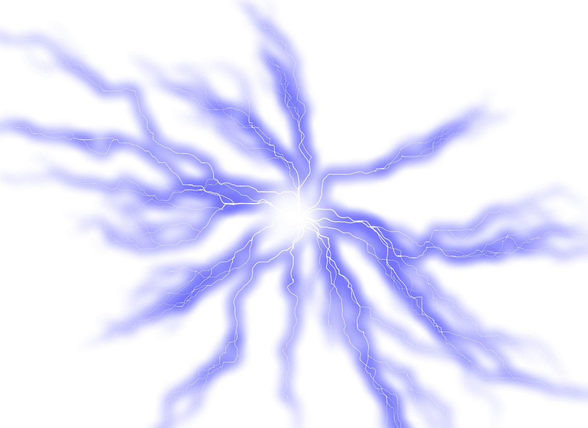

<p align="center">
  
</p>

<h1 align="center">Chidori ⚡ — GPU-over-IP</h1>

<p align="center">Transparent remote GPU access for CUDA compute workloads over TCP/IP.</p>

Run any CUDA application on a machine with **no GPU** — Chidori intercepts CUDA API calls via `LD_PRELOAD` and forwards them to a remote GPU server over the network. The application doesn't know the GPU is remote.

```
CLIENT (no GPU)                         SERVER (has GPU)
===============                         ================

  Your App (unmodified)                  chidori-worker
       |                                      |
  [LD_PRELOAD]                           [Real CUDA API]
       |                                      |
  libchidori.so  ──── TCP/IP ────>       H100 / H200 / etc.
```

## Proven Working

- **PyTorch**: `tensor([1.], device='cuda:0')` on a remote H100 from a GPU-less machine
- **8x H100-*80GB**: All GPUs detected and usable (`torch.cuda.device_count() → 8`)
- **50/50 tests passing**: Device queries, 16MB data round-trips, DtoD copies (0 bytes over wire), multi-GPU, streams, events
- **~280 CUDA functions intercepted**: Driver API, Runtime API, cuBLAS, cuDNN, plus 150+ stubs

## Quick Start

### Two-shell approach

**Terminal 1 — GPU Server** (has NVIDIA GPU + CUDA):
```bash
cd chidori-worker/tests
./start-server.sh 43211
```

**Terminal 2 — Client** (no GPU needed):
```bash
cd chidori-worker/tests
./run-test.sh <gpu-server-ip> 43211
```

### Manual setup

**GPU Server:**
```bash
cd chidori-worker
make server
./build/chidori-worker --standalone 43211
```

**Client:**
```bash
cd chidori-worker
make client

CHIDORI_DIRECT_CONNECT=1 \
CHIDORI_CFG_OVERRIDE='{"id":"test","servers":["GPU_SERVER_IP:43211"]}' \
LD_PRELOAD=./build/libchidori.so \
your_cuda_application
```

### PyTorch

```bash
# Copy libchidori.so as libcuda.so.1 so PyTorch's bundled cudart finds it
cp build/libchidori.so build/libcuda.so.1

CHIDORI_DIRECT_CONNECT=1 \
CHIDORI_CFG_OVERRIDE='{"id":"test","servers":["GPU_SERVER_IP:43211"]}' \
LD_LIBRARY_PATH=./build \
LD_PRELOAD=./build/libchidori.so \
python3 -c "import torch; torch._C._cuda_init(); x = torch.tensor([1.0]).cuda(); print(x)"
```

## Project Structure

```
chidori/
├── chidori-worker/          ← CUDA interception layer (C)
│   ├── src/server/          ← chidori-worker binary (runs on GPU host)
│   ├── src/client/          ← libchidori.so (LD_PRELOAD on client)
│   ├── src/protocol/        ← Wire protocol (16B req / 12B resp headers)
│   ├── codegen/             ← Auto-generates stubs from cuda.h
│   └── tests/               ← Protocol + e2e + remote GPU + PyTorch tests
│
└── control-plane/           ← Session orchestration (Go)
    ├── cmd/agent/           ← Runs on GPU hosts, manages sessions
    ├── cmd/controller/      ← Central scheduler
    └── cmd/juicify/         ← Client CLI launcher
```

## How It Works

### Why GPU-over-IP is possible

CUDA applications never touch GPU memory directly — everything goes through API calls that return opaque handles. A `CUdeviceptr` is just a 64-bit number your CPU code never dereferences. Replace the bottom layer with a network proxy and the application can't tell the difference.

### Wire Protocol

Binary protocol optimized for low latency:

```
Request  [16B]: msg_len(4) | func_id(2) | flags(2) | seq_num(4) | payload_size(4)
Response [12B]: msg_len(4) | seq_num(4) | result(4)
```

### Interception

`libchidori.so` exports all CUDA Driver API symbols (`cuInit`, `cuMemAlloc`, `cuLaunchKernel`, etc.). When loaded via `LD_PRELOAD`, it intercepts every CUDA call, serializes the arguments, sends them over TCP, and returns the result.

### Server

`chidori-worker` receives serialized CUDA calls, executes them on the real GPU, and sends back results. Handles for contexts, modules, functions, streams, and events are mapped between wire protocol IDs and real CUDA handles.

### DtoD = Zero Network Bytes

`cuMemcpyDtoD(dst, src, 16MB)` sends only 24 bytes over the network. The actual copy happens entirely on the remote GPU. This is why ML workloads perform well — most data movement is GPU-internal.

## Status

| Component | Status |
|-----------|--------|
| CUDA Driver API | Working (~30 functions) |
| CUDA Runtime API | Working (~26 functions) |
| cuBLAS | Working (~27 functions) |
| cuDNN | Working (~47 functions) |
| Symbol stubs | Working (~150 functions) |
| Multi-GPU (8x H100) | Working |
| PyTorch | Working (tensor ops, matmul) |
| Agent-mediated mode | Working (with socket fix) |
| GPU isolation | Not yet |
| NCCL | Not yet |
| TLS | Not yet |

## Background

This project revives [Juice Labs](https://github.com/Juice-Labs/Juice-Labs), which built a GPU-over-IP system that was abandoned and partially closed-sourced. The proprietary GPU interception binary has been replaced with an open-source implementation. The Go control plane has been updated to use NVML directly and target Linux only.

## License

MIT
